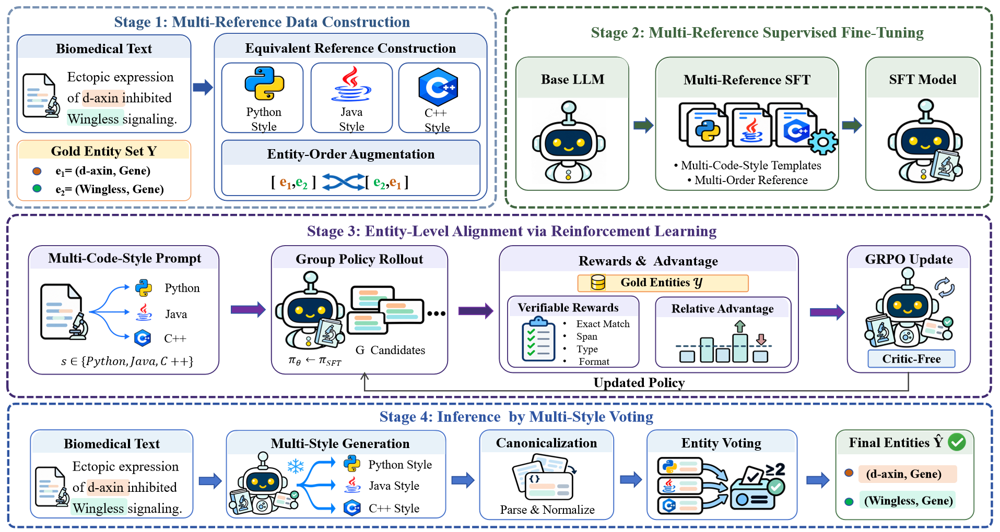

# MCS-ELA

**Multi-Code-Style Supervision and Entity-Level Alignment for Generative Biomedical Named Entity Recognition**

[📄 Paper](oup-authoring-template.pdf)

MCS-ELA combines Python, Java, and C++ style supervision with entity-guided GRPO training and multi-style voting for biomedical named entity recognition.

---

## 🏗️ Architecture



---

## 🚀 Quick Start

Run the following commands from the repository root, where `README.md` is located.

### 1. 📦 Installation

```bash
python -m pip install -e ./ms-swift
```

Set up compatible PyTorch, CUDA, vLLM, and SwanLab dependencies following the [installation guide](ms-swift/README_CN.md).

### 2. 📄 Prepare Data

The repository includes the base NL-format train/dev/test splits for BC2GM, BC4CHEMD, BC5CDR, JNLPBA, and NCBI-Disease. Code-style and GRPO data are generated locally.

```bash
python MCS-ELA/tools/build_code_style_dataset.py \
  --data-dir MCS-ELA/data/bc2gm1
```

Choose `bc2gm1`, `bc4chemed`, `bc5cdr_disease`, `bc5cdr_chemical`, `jnlpba`, or `ncbi_disease`. Both BC5CDR settings are generated from the shared `bc5cdr` source data.

### 3. ⚙️ Train

```bash
MODEL=/path/to/Qwen3-8B CUDA_VISIBLE_DEVICES=0 \
  bash MCS-ELA/scripts/run_main_experiment.sh bc2gm1
```

Set `MODEL` to your Qwen3-4B or Qwen3-8B model path.

### 4. 📊 Evaluate

```bash
python MCS-ELA/tools/eval_swift_bioner_f1.py \
  --input predictions.jsonl --output metrics.json
```

The prediction file contains `response` and `labels`. Evaluation reports entity-level micro precision, recall, and F1.

---

## 📂 Project Structure

```text
.
├── README.md
├── MCS-ELA/
│   ├── data/                   # Base NL-format datasets
│   ├── scripts/
│   │   └── run_main_experiment.sh
│   └── tools/                  # Data preparation, training, and evaluation
├── ms-swift/                   # Training framework
├── figure/
│   └── framework.png
└── oup-authoring-template.pdf
```

Built on ms-swift. See its [license](ms-swift/LICENSE).
